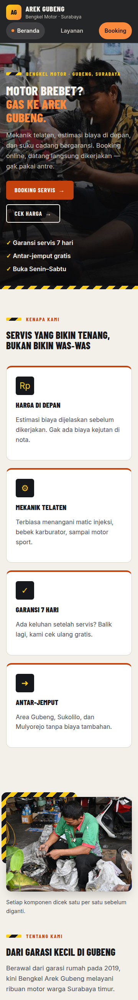
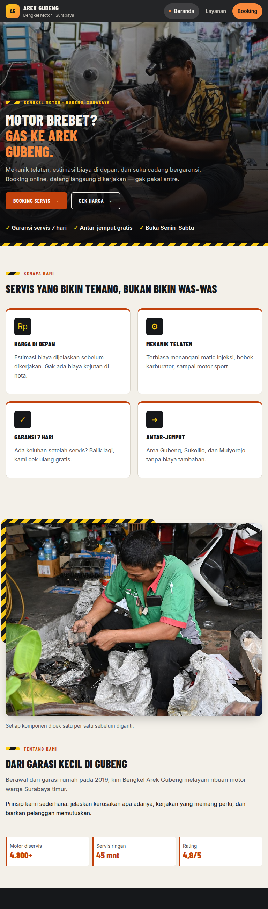
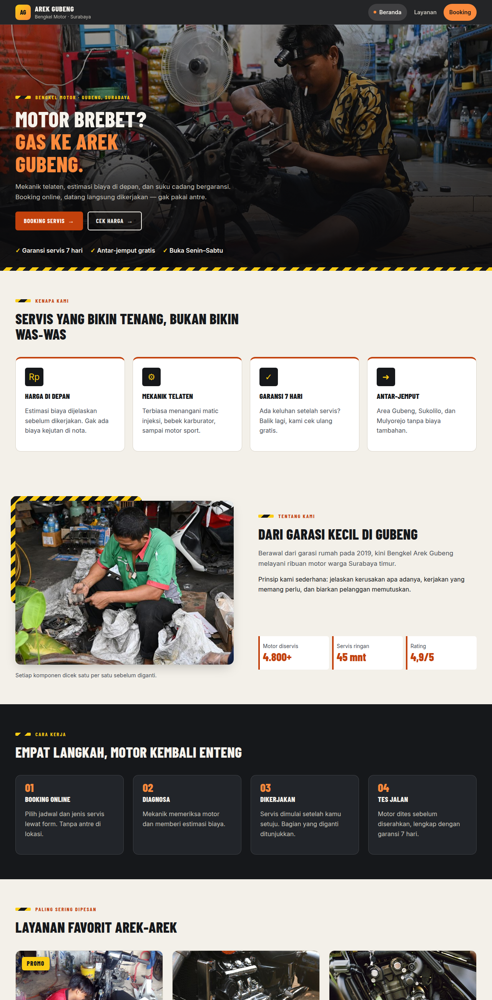
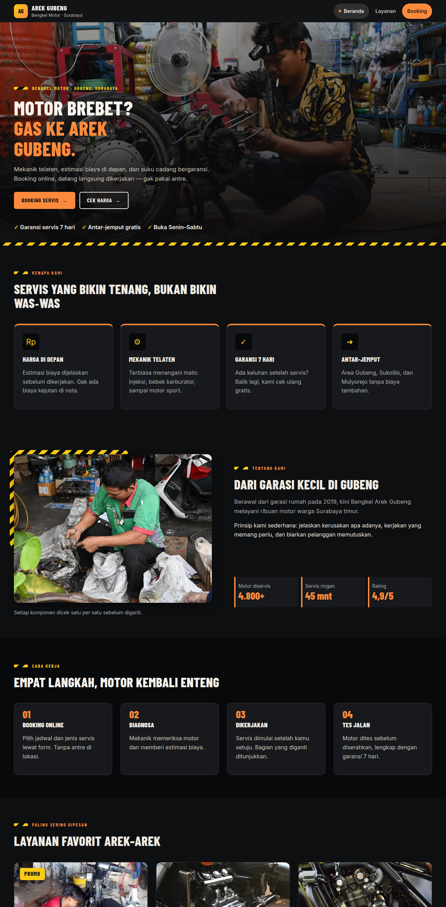
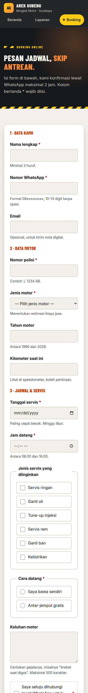
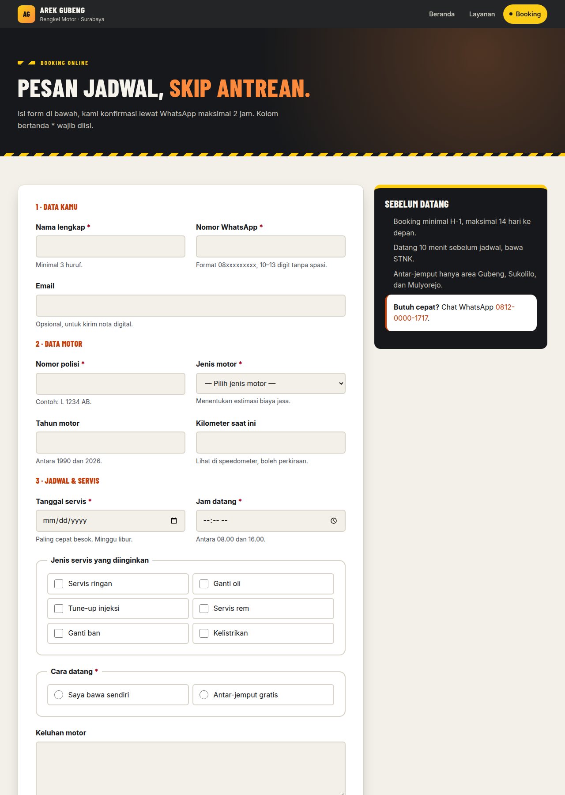
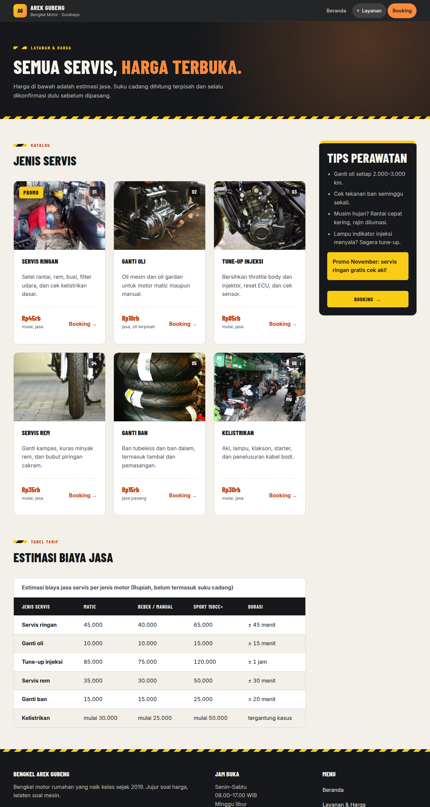

# Bengkel Arek Gubeng — UTS Pemrograman Antarmuka Web

Situs multi-halaman untuk bengkel motor fiktif di Gubeng, Surabaya.
Dibuat dengan HTML5 semantik, CSS sendiri, dan **Tailwind CSS v4** tanpa JavaScript buatan sendiri.

- **GitHub Pages:** https://mutawakkilalallah.github.io/uts-paw-p1-bengkel-arek-gubeng/
- **Repositori:** https://github.com/mutawakkilalallah/uts-paw-p1-bengkel-arek-gubeng

## Anggota

| NPM | Nama | Akun GitHub | Halaman yang dikerjakan |
|---|---|---|---|
| 06.2026.1.82018 | Mutawakkil Alallah | mutawakkilalallah | Semua halaman (dikerjakan sendiri): `index.html`, `layanan.html`, `booking.html`, `terima-kasih.html` |

## Sub-tema, nama usaha, target pengguna

- **Sub-tema:** 9 — Bengkel motor
- **Nama usaha:** Bengkel Arek Gubeng (fiktif)
- **Target pengguna:** pengendara motor di Surabaya timur (mahasiswa, pekerja, ojol) yang ingin tahu estimasi biaya dan booking servis tanpa antre, terutama lewat ponsel.

## Sitemap

```
index.html          Beranda: hero, keunggulan (kartu), statistik, testimoni, CTA
├── layanan.html    Katalog layanan (galeri kartu auto-fit) + tabel estimasi biaya
├── booking.html    Form booking servis (method="get")
│   └── terima-kasih.html   Konfirmasi setelah form dikirim
```

## Sketsa denah

```
MOBILE (< 40em)              DESKTOP (≥ 64em)
┌──────────────────┐         ┌──────────────────────────────────┐
│ header (sticky)  │         │ logo              nav (flex)     │
├──────────────────┤         ├────────────────┬─────────────────┤
│ hero: text       │         │ hero: text     │ hero: media     │
│ hero: media      │         ├────────────────┴─────────────────┤
├──────────────────┤         │ kartu │ kartu │ kartu │ kartu    │
│ kartu (1 kolom)  │         ├──────────────────────────────────┤
│ kartu            │         │ testimoni │ testimoni │ testimoni│
├──────────────────┤         ├──────────────────────────────────┤
│ testimoni        │         │ footer: alamat │ jam buka        │
├──────────────────┤         └──────────────────────────────────┘
│ footer           │         layanan.html: grid-template-areas
└──────────────────┘         "content aside" (aside sticky)
```

## Tabel token (custom property di `:root`)

| Token | Terang | Gelap | Dipakai untuk |
|---|---|---|---|
| `--c-bg` | `#f3f0e9` | `#0e0f11` | Latar halaman (warna beton) |
| `--c-surface` | `#ffffff` | `#17191c` | Kartu, form, tabel |
| `--c-text` | `#16181b` | `#eeeae2` | Teks utama |
| `--c-muted` | `#4b5058` | `#a9adb3` | Teks sekunder |
| `--c-primary` | `#c2410c` | `#fb8a3c` | Tombol, tautan, harga |
| `--c-primary-hover` | `#9a330a` | `#fdab72` | Hover tombol |
| `--c-on-primary` | `#ffffff` | `#111214` | Teks di atas primary |
| `--c-border` | `#d9d4c9` | `#2c3036` | Garis tepi |
| `--c-error` | `#b00020` | `#ff8a8a` | Validasi form |
| `--c-focus` | `#1d4ed8` | `#93c5fd` | Outline `:focus-visible` |
| `--c-dark` / `--c-dark-2` | `#16181b` / `#22252a` | `#08090a` / `#17191c` | Header, hero, pita gelap, footer |
| `--c-on-dark` / `--c-on-dark-muted` | `#f6f3ec` / `#c9c5bc` | sama | Teks di area gelap |
| `--c-hazard` | `#facc15` | sama | Garis hazard kuning-hitam, badge Promo |
| `--c-accent` | `#fb8a3c` | sama | Highlight judul, logo |
| `--hazard` | `repeating-linear-gradient(...)` | — | Pola garis hazard |
| `--font-head` / `--font-body` | Barlow Condensed / Inter | — | Tipografi (2 keluarga) |
| `--space-1..5` | 0.5 / 1 / 1.5 / 2.5 / 4rem | — | Spasi |
| `--radius`, `--radius-lg` | 0.375rem, 0.875rem | — | Sudut membulat |
| `--shadow`, `--transition` | — | — | Bayangan, durasi transisi (0ms saat reduced-motion) |

Mode gelap memakai `@media (prefers-color-scheme: dark)` dan hanya mengganti nilai token.

## Tabel breakpoint (mobile-first)

| Breakpoint | Perubahan |
|---|---|
| dasar (< 40em) | Semua grid 1 kolom; area Tentang `"media" "text" "stats"`; nav membungkus |
| `min-width: 40em` | Testimoni 2 kolom, langkah 2 kolom, form 2 kolom, opsi checkbox 2 kolom, footer 2 kolom, keunggulan 2 kolom (Tailwind `sm:`) |
| `min-width: 64em` | Area Tentang `"media text" "media stats"`, testimoni 3 kolom, langkah 4 kolom, footer 3 kolom, layanan `"content aside"` + aside sticky, form + kartu info berdampingan, keunggulan 4 kolom (Tailwind `lg:`) |

## Framework vs CSS sendiri (E4)

**Framework:** Tailwind CSS v4 (build lewat `@tailwindcss/cli`, hasil di `css/tailwind.css`).
Kustomisasi ada di blok `@theme inline` pada `css/tailwind-input.css`. Warna (`primary`, `accent`, `surface`, …) dan font Tailwind diarahkan ke token di `css/style.css`, jadi mode gelap otomatis ikut.
Build ulang: `npm install && npm run build:css`.

`css/style.css` dimuat **setelah** `css/tailwind.css` di semua halaman.

| Bagian | Framework (Tailwind) | CSS sendiri |
|---|---|---|
| Grid kartu keunggulan (Beranda) | `grid sm:grid-cols-2 lg:grid-cols-4` | — |
| Badge jam buka, alert info (Booking), catatan promo | utilitas `rounded-full bg-accent`, `border-l-4 border-primary` | — |
| Grup tombol, spasi | `flex flex-wrap gap-3`, `mt-*`, `p-*` | — |
| Navbar, header sticky, skip link | — | `.nav`, `.site-header` |
| Kartu, badge Promo absolute, tombol | — | `.card`, `.badge-promo`, `.btn` |
| Hero foto penuh, garis hazard, langkah bernomor (`counter()`) | — | `.hero`, `--hazard`, `.steps` |
| Bagian Tentang & layout layanan | — | `grid-template-areas` |
| Galeri layanan | — | `repeat(auto-fit, minmax(…))` |
| Form, validasi `:user-invalid`, tabel | — | `.form`, `.field`, `table` |

**Perbandingan komponen yang sama: alert info**

```html
<!-- Tailwind -->
<div class="rounded-lg border-l-4 border-primary bg-surface p-4" role="note">…</div>
```

```css
/* CSS murni */
.alert { border-radius: var(--radius); border-left: 4px solid var(--c-primary);
         background: var(--c-surface); padding: var(--space-2); }
```

Tailwind lebih cepat untuk komponen kecil yang jarang dipakai ulang karena tidak perlu membuat nama class baru. Untuk komponen yang dipakai berulang dan punya banyak state (kartu, tombol, form), CSS sendiri lebih rapi, tidak membuat HTML penuh class, dan lebih mudah diubah lewat token.

## Tangkapan layar

| 360px | 768px | 1280px | Mode gelap |
|---|---|---|---|
|  |  |  |  |

Tambahan:   

## Hasil pengujian

| Halaman | W3C Validator | Lighthouse Accessibility |
|---|---|---|
| index.html | 0 error | `<isi skor>` |
| layanan.html | 0 error | `<isi skor>` |
| booking.html | 0 error | `<isi skor>` |
| terima-kasih.html | 0 error | `<isi skor>` |

**Uji keyboard:** `Tab` pertama menampilkan skip link "Lewati ke konten utama". Semua tautan nav, tombol, dan kontrol form bisa dijangkau dengan `Tab`/`Shift+Tab`, dan outline fokus selalu terlihat. Radio dipilih dengan tombol panah, checkbox dengan `Spasi`, dan form dikirim dengan `Enter`. `<lengkapi setelah diuji manual>`

## Sumber gambar & ikon

Semua foto diambil dari **Wikimedia Commons** dengan lisensi Creative Commons yang mengizinkan pemakaian ulang dengan atribusi. Foto sudah **dipotong dan diperkecil** (diubah dari aslinya) agar pas untuk kartu dan `srcset`. Untuk foto berlisensi CC BY-SA, hasil modifikasinya dibagikan dengan lisensi yang sama.

| File | Dipakai di | Judul asli & sumber | Pembuat | Lisensi |
|---|---|---|---|---|
| `img/hero-800.jpg, img/hero-1600.jpg` | Hero beranda | [DFC 4703 A mechanic works on a motorcycle engine on the workshop floor focused on repairing the bike amid tools and parts.jpg](https://commons.wikimedia.org/wiki/File:DFC_4703_A_mechanic_works_on_a_motorcycle_engine_on_the_workshop_floor_focused_on_repairing_the_bike_amid_tools_and_parts.jpg) | PattayaPatrol | [CC BY-SA 4.0](https://creativecommons.org/licenses/by-sa/4.0) |
| `img/bengkel-640.jpg, img/bengkel-1200.jpg` | Bagian Tentang (figure) | [DSC 9542 A mechanic crouches amid tools and parts inspecting a small component while surrounded by sacks and scooter pieces in a busy repair shop.jpg](https://commons.wikimedia.org/wiki/File:DSC_9542_A_mechanic_crouches_amid_tools_and_parts_inspecting_a_small_component_while_surrounded_by_sacks_and_scooter_pieces_in_a_busy_repair_shop.jpg) | PattayaPatrol | [CC BY-SA 4.0](https://creativecommons.org/licenses/by-sa/4.0) |
| `img/servis-ringan-640.jpg` | Kartu Servis Ringan | [Mekanik motor - motorcycle mechanic.jpg](https://commons.wikimedia.org/wiki/File:Mekanik_motor_-_motorcycle_mechanic.jpg) | madmalaysia | [CC BY-SA 4.0](https://creativecommons.org/licenses/by-sa/4.0) |
| `img/ganti-oli-640.jpg` | Kartu Ganti Oli | [DSC 9329 Close-up of a polished chrome motorcycle engine and foot pegs catching the sunlight.jpg](https://commons.wikimedia.org/wiki/File:DSC_9329_Close-up_of_a_polished_chrome_motorcycle_engine_and_foot_pegs_catching_the_sunlight.jpg) | PattayaPatrol | [CC BY-SA 4.0](https://creativecommons.org/licenses/by-sa/4.0) |
| `img/tune-up-640.jpg` | Kartu Tune-Up | [Detailed view of a motorcycle engine showing craftsmanship and design.jpg](https://commons.wikimedia.org/wiki/File:Detailed_view_of_a_motorcycle_engine_showing_craftsmanship_and_design.jpg) | Shixart1985 | [CC BY 2.0](https://creativecommons.org/licenses/by/2.0) |
| `img/rem-640.jpg` | Kartu Servis Rem | [Honda NTV650 Motorcycle (1993) Front Tyre (14768216051).png](https://commons.wikimedia.org/wiki/File:Honda_NTV650_Motorcycle_(1993)_Front_Tyre_(14768216051).png) | Dennis van Zuijlekom from Ermelo, The Netherlands | [CC BY-SA 2.0](https://creativecommons.org/licenses/by-sa/2.0) |
| `img/ban-640.jpg` | Kartu Ganti Ban | [Motorcycle tyre stack.jpg](https://commons.wikimedia.org/wiki/File:Motorcycle_tyre_stack.jpg) | Robert | [CC BY 2.0](https://creativecommons.org/licenses/by/2.0) |
| `img/kelistrikan-640.jpg` | Kartu Kelistrikan | [Motorcycle repair shop, Bangkok (8270996736).jpg](https://commons.wikimedia.org/wiki/File:Motorcycle_repair_shop,_Bangkok_(8270996736).jpg) | Ian Gratton from Sutton-n-Craven, North Yorkshire, England | [CC BY 2.0](https://creativecommons.org/licenses/by/2.0) |

- Ikon pada kartu keunggulan dan logo "AG" memakai karakter teks/Unicode, bukan gambar pihak ketiga.
- Font: Barlow Condensed dan Inter dari Google Fonts (SIL Open Font License 1.1).

## Pernyataan penggunaan AI

- **Alat:** Claude Code (Anthropic).
- **Dipakai untuk:** membuat kerangka awal HTML, CSS, dan README, serta pengecekan W3C dan tangkapan layar.
- **Dikerjakan sendiri:** `<jelaskan bagian yang kamu ubah/periksa sendiri>`.
